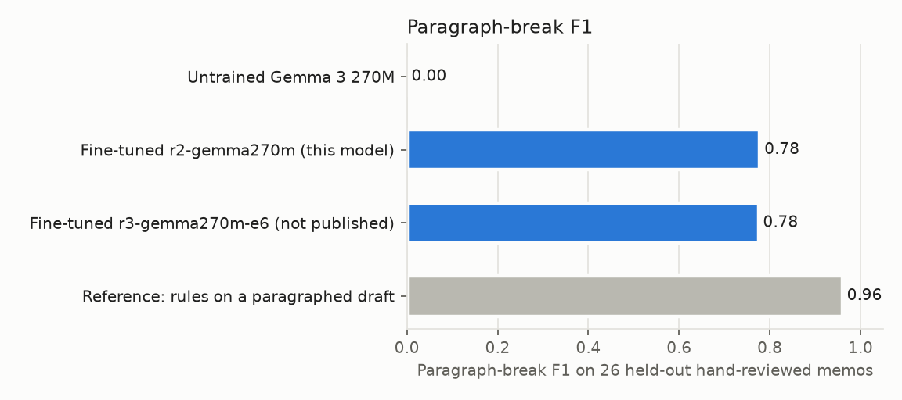
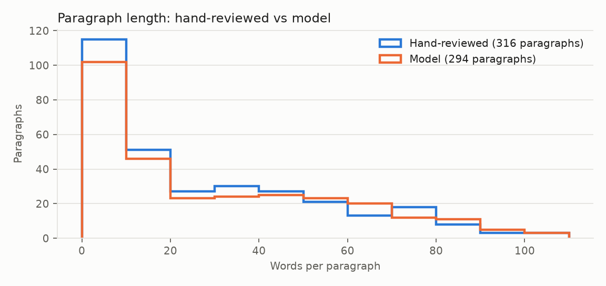
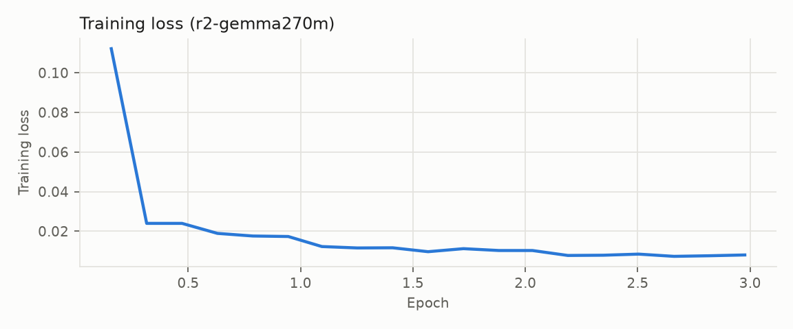

# Gemma 3 270M: ASR paragraph breaks

Adds paragraph breaks to flat speech-to-text output and changes nothing else. Speech recognition
(here, a Parakeet fine-tune) returns punctuated, cased text as one block; this model returns the same
text with paragraphs separated by blank lines. It is small enough to run on a phone after the ASR pass.
An ONNX export for ONNX Runtime is at [`danielrosehill/Gemma-3-270M-ASR-Paragraph-Breaks-ONNX`](https://huggingface.co/danielrosehill/Gemma-3-270M-ASR-Paragraph-Breaks-ONNX).
Try it in the [demo Space](https://huggingface.co/spaces/danielrosehill/ASR-Paragraph-Breaks-Demo) (CPU; optionally chains the email key-line bolding model).

## Results

Scored on 26 held-out synthetic voice memos whose paragraph breaks were reviewed by hand, as
break-position precision and recall. Any output that changes a non-whitespace character counts as a
fallback: the input is returned unchanged, as it should be in deployment.

| Model | Precision | Recall | F1 | Fallbacks |
|---|---|---|---|---|
| Untrained Gemma 3 270M | 0.00 | 0.00 | 0.00 | 26 of 26 |
| Fine-tuned r2-gemma270m (this model) | 0.84 | 0.72 | 0.78 | 2 of 26 |
| Fine-tuned r3-gemma270m-e6 (not published: 804 pairs, 6 epochs) | 0.83 | 0.72 | 0.78 | 1 of 26 |



The grey reference row is the rule-based labeller used to make most of the training data. It starts
from an already-paragraphed draft, so it is a ceiling, not a like-for-like baseline: the model starts
from flat text.





## Usage

Always check the output: if anything other than whitespace changed, use the input instead.

```python
import re
from transformers import AutoModelForCausalLM, AutoTokenizer

tok = AutoTokenizer.from_pretrained("danielrosehill/Gemma-3-270M-ASR-Paragraph-Breaks")
model = AutoModelForCausalLM.from_pretrained("danielrosehill/Gemma-3-270M-ASR-Paragraph-Breaks")
SYSTEM = ("Add paragraph breaks to this voice-note transcript. Separate paragraphs with a blank line. "
          "Do not change, add or remove any word or punctuation mark.")

def paragraph(text: str) -> str:
    prompt = tok.apply_chat_template([{"role": "system", "content": SYSTEM}, {"role": "user", "content": text}],
                                     tokenize=False, add_generation_prompt=True)
    enc = tok(prompt, return_tensors="pt")
    out = model.generate(**enc, max_new_tokens=1600, do_sample=False)
    pred = tok.decode(out[0][enc["input_ids"].shape[1]:], skip_special_tokens=True).strip()
    same = re.sub(r"\s+", "", pred) == re.sub(r"\s+", "", text)
    return pred if same else text
```

## Training

Full fine-tune of [`google/gemma-3-270m-it`](https://huggingface.co/google/gemma-3-270m-it) with TRL SFT
on prompt/completion pairs (completion-only loss): 505 training pairs, 3 epochs, learning
rate 5e-05, bf16, one NVIDIA L4 on Modal (run `asr-paragraph-r2-gemma270m`).

Data: [`danielrosehill/ASR-Paragraph-Breaks`](https://huggingface.co/datasets/danielrosehill/ASR-Paragraph-Breaks)
(the exact train/test split is in its `training/` folder). Synthetic voice-memo transcripts were written
by Claude Haiku 5.5, a minority of them paragraphed by hand, and the rest labelled by rules derived from
those hand edits. Code: [github.com/danielrosehill/ASR-Paragraph-Breaks](https://github.com/danielrosehill/ASR-Paragraph-Breaks).

## Limitations

- English only, and trained on synthetic memos rather than real ASR output.
- The paragraphing style is one person's: short paragraphs, the opening line and each sign-off line
  on their own.
- Memos longer than about 700 words were not in training; split longer transcripts first.
- It is a generative model, so it retypes the whole text. Keep the fallback check.

Licence: Gemma Terms of Use, inherited from the base model.
